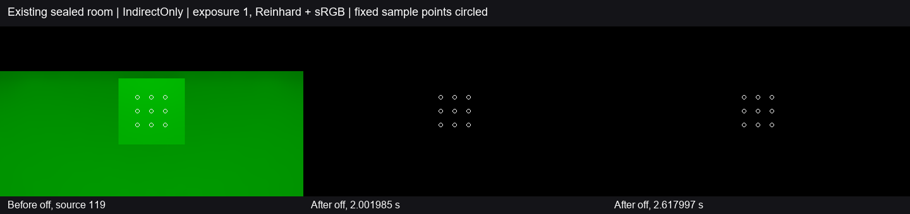

# 已有封闭反射房间的局部点光关断

**本房间固定九点的间接出射在关灯后持续消退，已观测源帧满足预定残留目标，末帧 filteredD 仍有效。** 这补上 G1／G3 原来只有“始终未被照亮的封闭室”和“开放墙面全源关断”的适用范围缺口。没有发现需要修改产品的具体反例；Release122 保持，整体 G1／G3 及任意房间的长期能量结论继续开放。Astra Max 与独立只读审阅均同意按下述范围采用并结束。

三图为实际普通 Feature 的 **IndirectOnly 间接出射贡献**，曝光1、Reinhard 后转 sRGB，白圈为固定采样点。原生点光直射没有进入衰减分母。很弱的末端绿色在这个显示尺度下近黑；图黑不代表严格零值。

## 关闭的原计划缺口

原 G1 要求能量控制与关灯衰减。既有黑室从切镜时就是黑，室外光源仍开；开放棕墙／白地板与两节点函数参考也不能代替真实封闭空间的这个事件。本次复用开发工程保存的 `Assets/UnifiedRelease74/Generated/Scenes/Run/Validation.unity` 六面相交封闭墙和内部灰接收体，不重造几何；保留原普通 Lit 材质反射率、SDF 和 charts。**该保存场景不在 Release122 portable ZIP 中**，本次只沿用122的产品与管线／质量设置，不能把场景来源也写成122 ZIP。

2026-11-04，本机 RTX2080Ti／DX12、Unity6000.0.85f1；960×540、半分辨率 GI、2射线／4级滤波、temporal 开、bounceFeedback=1，GPU计时／预算反馈关闭。七个房间网格实际全走DXR，无fallback或材质unknown。其他对象及驱动隔离；从开始环境、SH、反射、烘焙和发光均为零，唯一活动源是移到房内 (16,2,-.5) 的原点光，纯绿、intensity20、range10、bounceIntensity1。

固定正交镜头朝向灰块，九个 full 像素由 x=435／479／523、y=225／269／313 的笛卡尔积确定，均位于半 GI 中心，没有按亮度或有效性改选。初始和末端 Capture 的原生／捕获深度一致；独立反投影得到源灰块正面 z≈0.29999844，最大位置差约1.56×10⁻⁶米，材质与原颜色／漫反射分配一致。七墙／接收体源顶点、索引、矩阵、bounds及实际 GPU 代理行保留在数据包中。

第119逻辑源帧已取得可信非零间接出射，九点 G 均值 **0.80179743**；该帧渲染结束后仅禁用点光，没有切镜、改材质或手工清历史。事件按**局部点光移除**分类：1秒≤5%、2秒≤1%，并保持后续至少0.5秒；没有改用全局5秒期限。源时间在请求前记录，事件时间在关灯后记录，回读完成时刻另列。

## 实际结果

百分比按关断前同域旧绿色归一，最差点按各自关断前值归一；不除以黑终态。

| 实际源时间 | 旧绿区域均值剩余 | 最差点剩余 | temporal 无效点 |
| --- | ---: | ---: | ---: |
| 0.981452秒，1秒前 | 0.0460618% | 0.0495670% | 0 |
| 1.015656秒，1秒后 | 0.0423303% | 0.0455515% | 0 |
| 1.968233秒，2秒前 | 0.00405616% | 0.00436482% | 0 |
| 2.001986秒，2秒后 | 0.00373525% | 0.00401949% | 0 |
| 2.617997秒，末端 | 0.000806007% | 0.000867342% | 0 |

截止前样点及其后全部已观测源帧均保持对应目标。首个满足旧绿均值≤1%且 temporal 有效、保持≥0.5秒的观测窗口为 **0.0580805–0.5726233秒**。这只是固定区域的观测保持窗口，不是全画面或物理系统的精确收敛时刻。

末端实际 filteredD 九点均有效，最小 alpha=0.64990234、平均 G=1.2874603×10⁻⁵；Final 九点平均 G=6.4625465×10⁻⁶，R/B为零。末端 cameraBeforeHLGI 全图 RGB 为零，七个实际 GPU proxy 无发光，响应段灯表接纳数为零。没有把无效输出当黑，也没有要求有限时间内逐位归零。

响应源节奏实际29.2964Hz，中位／p95／最大间隔为34.154／35.156／35.277ms。Final与history回读中位滞后分别42.155／42.208ms；末端 Capture 排空0.962秒不计入源响应时间。这是显式请求观察，**不是应用 Present、GI时间或30FPS性能验收**。

## 不确定性与停止边界

- 采用范围为这间现成封闭房间、这一次点光事件、固定九点的间接出射消退。未直接读取 world cache 条目，不能把它写成完整多跳算子的收缩证明或任意房间不存在自维持能量。
- temporal alpha 表示有效储存估计，可能保留旧历史；没有观测 fresh raw 资格，也没有逐帧直读所有中间 filteredD。仅末端有实际 filteredD 及掩码核对。区域均值不代替全图、边界及其他接收面验收。
- 首次 `SealedDecay129` 在进入Play前因为资产引用跨 OpenScene 后失效而失败，native1、原入口和 editor-result 保留；没有生成产品画面。Astra 允许仅移动资产读取时机的一次准备更正，输入、阈值和采样不变，`SealedDecay129Corrected` 为唯一实际观察，native0且恢复成功。
- 冻结离线解释器首轮把 Unity Bounds 的 `m_Extent` 误写为 `m_Extents`，原解析失败保留；只修读取字段后得到上表。另核实既有末端原生画面为黑及响应 R/B=0，没有补渲染或调整阈值。

[逐源帧指标](analysis.json)与[data-and-source.zip](data-and-source.zip)保存原始收据、源/时序、采用所需原始平面、三张 Final、两次准备来源与解释器。包内 README 说明重放；本机原数据为 `I:/Unity test/Comparison/SealedDecay129Corrected`，未渲染失败为同级 `SealedDecay129`，各自 Setup 保留实际入口。按 Astra 复核，本项到此结束，不追加运行、调整权重、扩反射率或发版。
