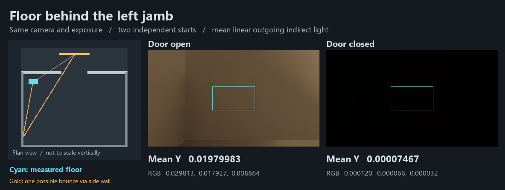

# 发光面被隔墙遮住时，前室地板能否收到暖光？

**能观测到随门洞变化的间接光。** 使用 Release103 的已保存两室场景，把相机移到左门框后方看地板。从这个接收区域到两块已发布暖色发光面的直线都穿过实墙。开门时区域平均线性亮度为 **0.01979983**，闭门时为 **0.00007467**。两种门姿均从独立启动开始，在第 119 帧读取同一地板区域。

| 分隔门 | 地板平均线性 RGB | 场景状态 |
| --- | --- | --- |
| 全开 | 0.029813，0.017927，0.008864 | 已选解析灯 0，实际 DXR，31 个网格，186 张就绪卡 |
| 全闭 | 0.000120，0.000066，0.000032 | 相同场景、机位、材质、环境与预算，门移至闭合位置 |

**如何确定光源被遮住。** 相机在世界坐标 `(−3.1, 1.3, −4.75)` 向下看。由实际投影和地板高度可得，中央 `[240,400) × [135,225)` 像素都落在地板上，世界范围约为 `x=[−3.434,−2.766]`、`z=[−4.938,−4.562]`。左隔墙在 `z=−4` 的截面覆盖 `x=[−4,−1]`、`y=[0,4]`。对距门最近的暖色面板，即使取最靠右的连线，它在这个截面也只有 `x≈−1.22`，仍落在墙体内。另一块原始发光面位于更左侧，两者的连线高度也都在墙体范围内。开门时，面板可先通过门洞照到前室左侧墙，再反弹到地板。示意图画出一条可行光路，测量没有分解各个表面的贡献。

**测量范围。** Unity 6000.0.85f1、URP 17.0.4、RTX 2080 Ti、DX12，640×360、半分辨率 GI、2 条射线、4 级滤波、多跳反馈 1、黑环境。相机采集普通 `IndirectOnly` 出射贡献。预览对两张图片均乘 4，再使用同一 Reinhard 和 sRGB 映射；表中数值取自映射前的浮点数据。两次各完成所请求的 120 帧，采集错误为零。闭门非零值如实保留，其来源及与物理真值的误差仍未知。这两幅图支持一个固定受遮区域的开闭差异；连续行走、多次转折及更大布局仍未验收。[两张原始 EXR](linear-frames.zip) · [读数、投影与发布状态](readings.json) · [同场景直通门洞的旧机位](../connected-rooms-01/result.md)
