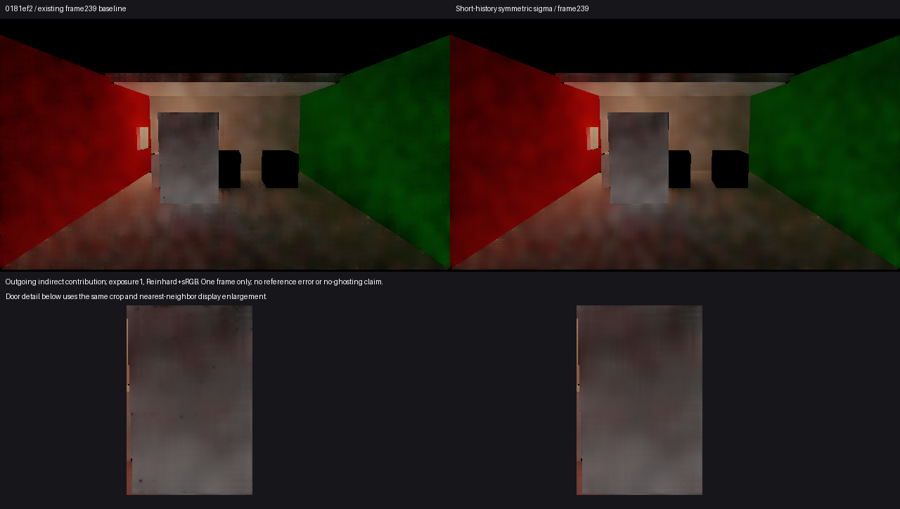

# 短历史运动颗粒的空间滤波改进

**有限采用。** 主线程、独立视觉审阅及Astra均在[同曝光239帧对照](comparison.png)中看到门面和邻近墙地的细小黑颗粒减少，未见足以阻止采用的新轮廓软化、串色或缺损；大尺度云状斑驳仍在。原目标1／工作流6取得一次具体降噪改进，不是完整G1/G3通过。

原亮度权重仅使用中心噪声尺度；低方差暗中心可以拒绝高方差亮邻居，而反向允许混合。候选仅在两端历史长度都在(0,4)、统计有效时，采用两端原尺度的算术平均。成熟历史或不完整统计保留原规则；Temporal、reactive限龄、known、几何／材质门及时间反馈未改。具体变更见[candidate.patch](candidate.patch)。对称性不等于守恒或无偏，新增邻居moments读取的成本未测。

唯一观察复用既有RigidPoseHistory01基线及其保存场景前史：精确软件，640×360普通输出／320×180 D，只采原0–239前缀的239。原119主射线owner网格定位门回到初始位置后的2739点，不使用119辐射作239真值。两侧known均2739，历史均为15点长度1、2724点长度2，门面moments最大差为0；平均D亮度0.124247→0.128129（约+3.12%），均值改变不代表准确度改善。数据见[comparison.json](comparison.json)；图使用曝光1、Reinhard和sRGB，显示时竖直翻转，局部图仅作等比例最近邻放大。

四项画质边界：**颜色误差**没有新的239独立参考，既有颜色偏差保持原来源；**换色／关灯残留**没有新增观察或时间规则修改；**运动拖影**只支持该时点颗粒改善，不能证明全过程无拖影；**收敛时间**没有新结论。此处空间滤波收益不替代整体正确颜色或动态验收。

Unity PID17940已终止，240渲染帧、failures0、backendMismatches0，239票据complete、readbacksCompleted、retainedBytes0。原720协议仍为failed，native exit1按主动前缀保留；不是完整序列通过。Unity导入完成受影响shader编译，临时Kernel、Sequence、Quality及场景副本已经恢复。没有新探针、单元矩阵、参考积分、哈希校验或成本窗口。

独立源码审阅指出的新分支中心统计有限性门已在唯一运行前补齐，没有运行后调参。采用本候选后仅做一次公开普通构建整合，不追加Player、DXR动态或采图；这条候选线到此结束。

已交付[Release87](<I:/Unity test/Comparison/Builds/LocalRelease87/Start-LocalRelease.cmd>)，源码e352921，Unity PID16336／native exit0；Release/None，0错误、23条warning、102084860字节。见[调用](build-attempt.json)、[退出](build-exit.json)和[构建结果](<I:/Unity test/Comparison/Builds/LocalRelease87/build-result.json>)。保存统一场景及本机DXR启动偏好沿用，构建后工程Renderer、Quality和初始化入口恢复；候选Kernel作为已采用产品源码留在本机工程。没有追加Player运行。
