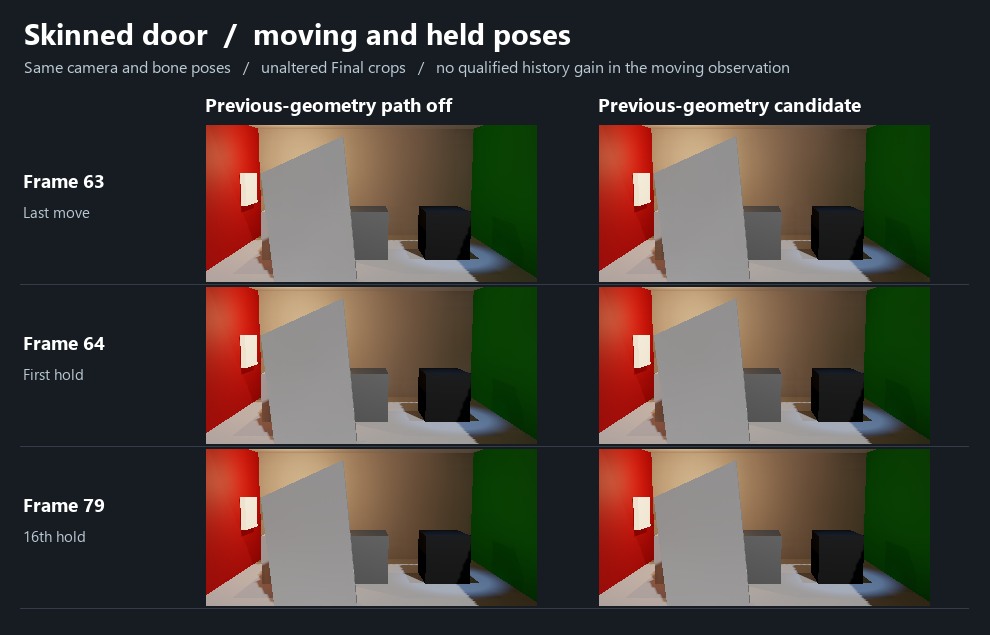

# 统一示例骨骼门的上一渲染帧顶点

在普通 Win64 Player 中，样例门从 +8° 弯到 −12°。相机连续渲染了同一片朝向镜头的蒙皮三角形，顶点索引为 10、7、11。**第 4 帧的 previous 缓冲在这三个顶点上逐点等于第 3 帧读到的 current 缓冲**，而第 4 帧的 current 已变为新姿态。按门的已保存骨权重计算，三角形中心在两姿态间移动 0.20856 米，前一姿态也与绑定姿态相距 0.08400 米。[原始读回](native-observation.json)

原观察器直接用 `Renderer.localToWorldMatrix` 换算 raw 顶点，得到约 3 米的错误。此门的根骨就是 Renderer，父级无旋转，已保存的位置为 `T=(−1.1,1.4,−0.8)`、缩放为 `S=(1.8,2.8,0.25)`。剔除重复乘入的一次缩放后，三个顶点与按当帧骨矩阵、绑定矩阵及权重独立计算的世界位置一致。对原记录 `O` 的处理是逐轴计算 `T+(O−T)/S`，未调整参数。帧 3 current、帧 4 previous 的最大误差均为 5.98×10⁻⁸ 米，帧 4 current 为 1.26×10⁻⁷ 米。原始 `not-established` 状态保留，反映第一次世界空间换算未通过。[同一读回修正后的逐点比较](comparison.json)

范围为 Unity 6000.0.85f1、D3D12、示例两骨门，位置为 Float32×3，stream 0、offset 0、stride 40、24 个顶点、baseVertex 0。相机只渲染此门所在层，两次相机回调分别发生在引擎帧 3、4。首次尝试未能通过全局对象枚举发现隐藏的 Skin，随后改从实际门 Proxy 的 `SourceRenderer` 取到产品使用的 Renderer。该采集确认了这份原生上一帧几何的来源；逐像素历史、完整动画的颗粒及拖影另行判断。[Unity 上帧顶点缓冲](https://docs.unity3d.com/6000.0/Documentation/ScriptReference/SkinnedMeshRenderer.GetPreviousVertexBuffer.html)

## 运动历史候选未采用

候选在身份绘制时读取 Unity 的 current 和 previous 蒙皮顶点，要求当前顶点与该次绘制的 POSITION 一致，前帧投影还须与 URP 运动矢量相符，之后才允许用上一帧深度判断历史。基线与候选均渲染了 80 个完整目标相机帧，逐帧骨姿态、相机、GI 工作帧与后端记录相同，设置和光源一致。

| 观察时点 | 门上可见身份像素 | 基线中历史长度 > 1 | 候选中历史长度 > 1 |
| --- | ---: | ---: | ---: |
| 第 63 帧，运动末帧 | 2722 | 0 | 0 |
| 第 64 帧，刚停 | 2722 | 2695 | 2695 |
| 第 79 帧，停住第 16 帧 | 2722 | 2695 | 2695 |

第 63 帧候选的 CPU 行已经取得形变资格（flags=2），但没有观察到门面的运动历史累计，因此无法确认运动颗粒改善。第 71 帧两侧的异步世界几何快照不同，三个观测点的原始 GI 也均未逐点一致。画面差异不能归因于历史候选，持续拖影没有新增结论。候选源码已从产品和本机 Unity 工程撤回；Release104 保留原有停稳历史行为。[状态与输入差异](quality.json) · [未采用的候选补丁](candidate-not-adopted.patch)
