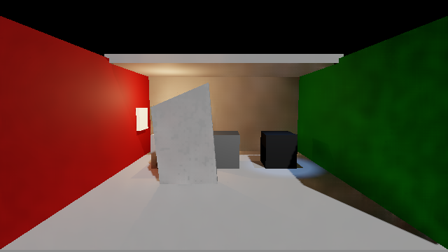

# 统一样例真实 Skinned 使用结果

已关闭的缺口是普通统一样例缺少可操作的真实 Skinned 来源。现在 `K` 可在两骨骼 Skinned 和原可读 Mesh 模式之间切换，`Space` 共用启停；Skinned 模式通过既有自动 `BakeMesh` 生成 GI 快照，切换和退出撤回旧来源并恢复作者 Renderer/mesh。这是已有形变能力的功能集成，没有重做快照、SDF/charts 或硬件更新算法。

## 本次实际结果

一个保存的普通样例完成有限 Unity 渲染序列，结果为 `passed`，原生退出码0。未增加第二个画质场景或性能窗口。

| 观测项 | 结果 |
| --- | --- |
| 相机渲染请求 | 141 |
| 运动中相邻已发布网格出现顶点变化 | 8次 |
| Skin / Mesh 的 PublishedFrame | 111 / 124 |
| 停稳骨骼角度 | 15.161499° |
| 停稳发布网格对真实 BakeMesh 的最大顶点差 | 0 |
| 真实 Skinned 来源 | true；捕获网格名 `HLGI baked deformation` |
| Feature 来源阶段 | Skin、Mesh 均为 `Published` |
| 旧 Skin 快照撤回 / 作者 mesh 恢复 | true / true |

`PublishedFrame` 表示快照捕获帧，不是 GPU fence 完成时间或光照延迟。主线程查看唯一停稳图，确认门具有可见的真实形变。该 Unity 使用序列已通过，Astra实际查看停稳图后同意采用，并停止本条验证。

原始结果：[usage-result.json](usage-result.json)。原生退出：[retry-native-exit.json](retry-native-exit.json)。

## 首次失败与修正范围

首尝试缺少临时驱动的 `SupportsRenderRequest` 启动检查，达到有界期限时仍为 `requests=0`，没有进入实际渲染。[首失败记录](startup-failure.json)保持原样，不能把其中默认零值当作成功测量。随后只修临时驱动启动，再完成上述唯一实际渲染序列；[修正](startup-fix.patch)依据 [Unity 6000.0 RenderPipeline 官方实现](https://raw.githubusercontent.com/Unity-Technologies/UnityCsReference/6000.0/Runtime/Export/RenderPipeline/RenderPipeline.cs)。该启动修正不是形变算法修改。

## 四项画质问题的边界

- **颜色误差：**本轮未新增独立颜色参考或误差评价，不能据停稳图宣称精度通过。
- **换色／关灯残留：**本轮没有重新评价这些响应，沿用[现有缓存来源分离结果](../cache-source-separation-01/result.md)的有限结论。
- **运动拖影：**实际姿态持续发布、停稳追上并成功切回，不等于无拖影证明；没有新增动态画质结论。
- **收敛时间：**顶点差0说明几何快照追上当前姿态，不说明光照已经收敛，也不能换算成统一收敛帧数。

已有颜色、残留、运动与收敛测量见[动态画面对照报告](../dynamic-picture-comparison-01/report.md)，其来源和局限保持不变。

## 版本整合

[Release79启动入口](<I:/Unity test/Comparison/Builds/LocalRelease79/Start-LocalRelease.cmd>)已用既有公开入口构建，继续复用原统一场景。Release/None、0错误/23条warning，见[构建结果](<I:/Unity test/Comparison/Builds/LocalRelease79/build-result.json>)。临时质量设置和初始化脚本已恢复，临时使用驱动已移除；普通Player没有另行启动。运行证据来自上述真实Unity使用序列，未追加图像、性能或Skinned配置矩阵。光传输保持Release78，已有颜色和成本结果保留各自来源。
