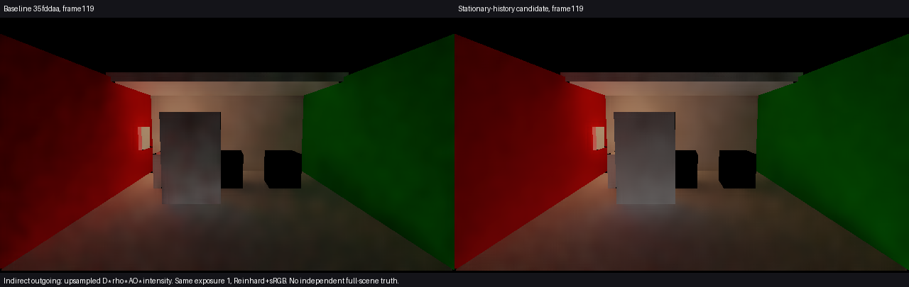
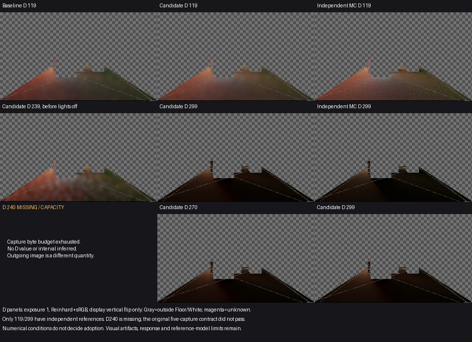
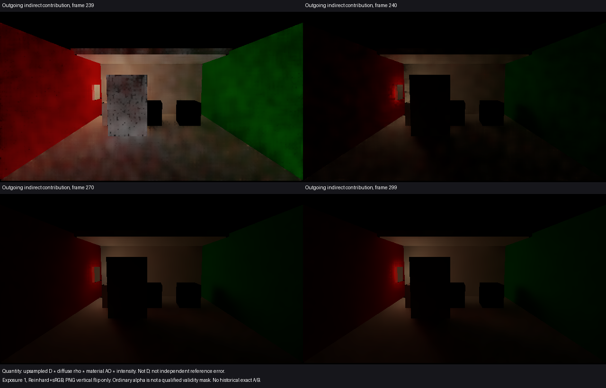

# 静止样本的重建偏暗修复

本候选针对一个具体功能缺口：相机和接收样本完全未变时，低采样当前邻域偶然漏掉亮路径，仍会把已积累的可信历史压暗。现在仅对通过原历史资格、达到现有MaxHistory、无reactive、VP/实际采样位置/几何/材质完全相同且motion/jitter为零的样本，保留最近同位置历史，跳过subpixel重建和RGB邻域裁剪。其余路径沿用原处理；没有新增参数、纹理或照明追踪机制。

**当前决定：经主线程、独立图像审阅及Astra阶段复核，有限采用。** 这不是整体动态或生产验收通过。未标记的真实照明变化会更慢消退，见下文明确代价。

## 颜色误差

同一保存场景、frame119、同量D=E/pi；固定原基线已知的Floor/White域，不通过删点得到改善。Floor13328点（原另有2点未知）、White86点，候选没有新增未知。

| ROI | 原平均Y偏差 | 候选平均Y偏差 | 原逐像素Y-MAE | 候选Y-MAE | 原/候选色向L1 |
| --- | ---: | ---: | ---: | ---: | ---: |
| Floor | −28.91% | **−5.84%** | 0.021369 | **0.010199** | 0.027067 / **0.004220** |
| White receiver | −33.39% | **−3.36%** | 0.075773 | **0.020113** | 0.069609 / **0.046113** |

两个ROI均满足执行前固定的均值偏差、MAE、色向和未知覆盖条件；RMSE也下降。原raw亮度时间矩几乎不变，支持此次收益来自重建处理，而非提高强度。主线程与独立审阅未见119固定域中明显新增亮点、边缘拖影或大块斑纹；完整出射图中地面和白接收体的斑块减少。

图是经过上采样的D×反射率×材质AO×强度，不能把它当作D数值参考。以下独立D图只显示原接收域，其余为灰棋盘。

参考沿用现有256spp、8次反弹CPU结果，没有重新积分。像素标准误均值不是ROI置信区间或总误差界；有限采样、几何/射线偏移、距离截断、缓存和滤波的模型差别保持。上述百分比是限定时点/ROI的偏差估计，不是整景准确度或稳态证明。

## 换色／关灯残留

实际temporal body的有限WARP比较中，已标记全局关灯、局部reactive、运动、显露拒绝、未知当前测量与未成熟历史保持旧输出。真实场景普通出射图在239→240明显变暗，270/299外观接近，并保留接收面发光反弹；没有观察到明确新增旧光轮廓。

**未标记变化的代价不能省略：**同位置history=1而当前真实变黑，32次依赖更新后，旧裁剪路径剩0.002745，候选剩0.068787，即约6.88%。它沿用原EMA，并没有新增持久状态，但明显比旧裁剪慢。有限宿主使用适配纹理和显式half存储，不是32个真实Unity帧或实测时长。MaxHistory只是配置相关的成熟窗口；来源通知、有限变化域外的多跳传播仍有局限。

本次没有新的局部换色画面结论。239门面颗粒和墙地斑驳仍可见；历史版本已有同类现象，但没有该时点的当前精确A/B，不能宣称本轮解决或证明完全不变。

## 运动拖影与收敛时间

免裁剪条件排除已读到的非零motion、相机VP变化、jitter及变化后的不匹配样本；identity忽略不一致motion时也不能误获例外。有限消费者控制保持，不替代任意相机/物体/TAA运动质量验收。此静态修复不声称“无拖影”，尤其不能把未标记变化的慢衰减隐藏为稳定性通过。

299相对既有独立参考的平均Y偏差为Floor **+0.144%**、White **−18.06%**；后者仍明显偏暗。270→299的逐像素平均绝对D亮度变化分别为0.00025053、0.00079249。只有有限时点，不能据此给出达到正确颜色的统一收敛帧数，也不能将299当作收敛真值。

## 采集缺口与范围

只运行了一次原场景0–299前缀，300个渲染帧、failures=0、backendMismatches=0。原720协议及native exit1保持为不完整，没有改写为整序列通过。Unity PID6568已退出，暂存工程输入恢复。

附加D票据119/239/270/299完整；**240因与239重叠触及Capture默认128MiB预算而缺失**。原五票据分析的[失败结果](comparison.json)保留。240普通HDR仍完整，但只用于视觉判断，不替代D或有效掩码；其D数值和240起始D区间保持缺失。没有补采、扩大预算或重跑。所有票据最终保留字节为0。

阶段复核允许依据现有完整119数据及普通关灯图作有限产品取舍，不把自行安排的五张D完整性变成新验证系统的前置要求；原质量条件没有降低。[可用数据结果](available-comparison.json)、[有限消费者结果](finite/summary.json)与[执行前决定](decision.md)分开保留。原参考、原失败和未标记变化代价均不改写。

[Release82统一入口](<I:/Unity test/Comparison/Builds/LocalRelease82/Start-LocalRelease.cmd>)已整合源码5e714f6。公开入口复用原统一场景，Release/None、0错误/23条warning、native exit0，见[构建结果](<I:/Unity test/Comparison/Builds/LocalRelease82/build-result.json>)；临时设置与初始化脚本恢复。未追加Player、画质或性能运行。本节点有限关闭严格静止条件下的历史重建偏暗缺口；完整G1/G3、局部换色、多跳传播、运动质量及生产预算仍开放。
