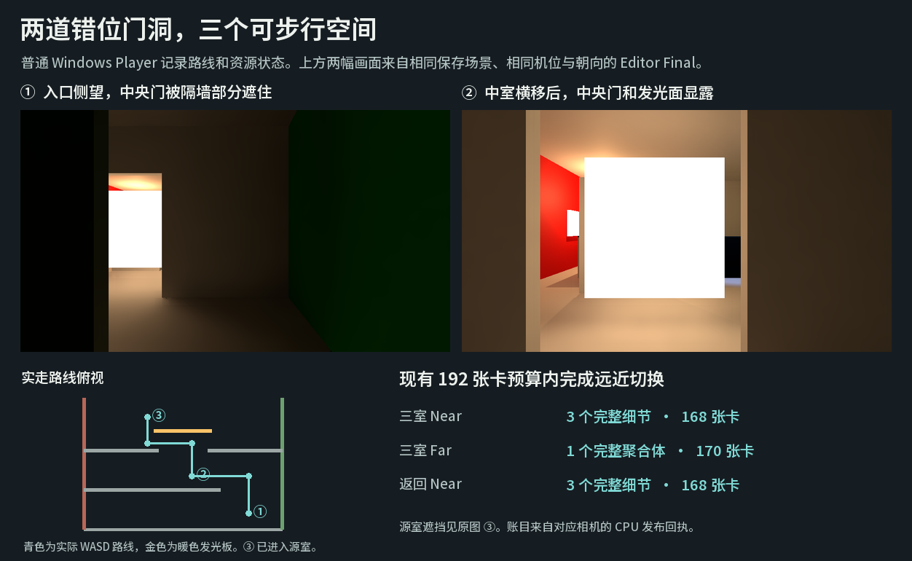

# 三室转向路线与远近场切换

Release105 在同一 Windows 示例中提供一条可以步行穿过的三室路线。按 **F3** 打开相邻两室，再按 **F4** 进入后室。用 **W** 穿过右侧开口，**A** 向中央门洞横移，再用 **W** 进入源室。**O** 控制中央滑门，**F4** 恢复原两室，**F3** 返回默认场景。相机使用原来的自由导航。

**门洞通行。** 普通 Player 的相机保持在高度 1.5。从 `(x,z)=(2.65,−8.80)` 前进至 `(2.65,−5.99)`，穿过位于 `z=−7`、`x>1.5` 的右侧开口。随后横移至 `(0.36,−5.99)`，再沿同一 x 前进至 `(0.36,−3.45)`，穿过位于 `z=−4`、`x=[−1,1]` 的中央门洞。相机在 `(−1.43,−3.45)` 绕到暖色板左侧，最后到达 `(−1.43,−1.46)`。这些位置由实际 WASD 操作和 F2 相机日志取得。[普通 Player 实走与发布记录](walk.json)

**容量与修复。** 第一版把第二块顶棚用作隔墙，仍有 186 张卡用于近场。192 张卡的上限只余 6 张，完整聚合体需要另预热 20 张；Far 两次读数均显示保留原细节且聚合体受预算阻塞。最终三室将源室的地板与红、绿侧墙延长到入口，替代三块重复表面。中央门、偏置隔墙与全部分页成员继续参与场景。原中性前室在切出三室时恢复。

| 普通 Player，实际 DXR | 请求与可用表示 | 可提交／绑定成员 | 已就绪卡 |
| --- | --- | ---: | ---: |
| 三室 Near | 细节／细节 | 3／4 | 168 |
| 三室 Far | 聚合体／聚合体 | 1／1 | 170 |
| 返回 Near | 细节／细节 | 3／4 | 168 |
| F4 恢复原两室 | 细节／细节 | 3／4 | 186 |
| F3 返回默认场景 | 细节／细节 | 3／4 | 120 |

**画面来源。** 窗口截图器在切换场景后报 `FrameArrived timed out`。图像来自同一保存场景的 Editor Play，按普通 Player 的实测机位和朝向重现，使用普通 Final 相机与原有灯光。入口处只能从偏置隔墙旁看到部分中央门；横移到中室中央后可见暖色板和后方红墙。源室末点靠近原示例的运动遮挡板，近处表面占满视野。[入口原图](view-1.png) · [中室原图](view-2.png) · [源室末点原图](view-3.png) · [采集设置与机位](views.json)

本次确认的是这条路线的遮挡与显露以及该布局的完整远近切换。原中性两室的近场仍使用 186 张卡；同样的 20 张预热需求会超出 192 张预算，这个模式的 Far 仍有限制。三室运行未重测物理颜色误差、动态收敛或 GPU 时间。普通 Win64／Mono／D3D12 构建使用独立保存的 `ThreeRoomPassage.unity`，0 个错误、23 个警告。[普通构建报告](build-result.json)
