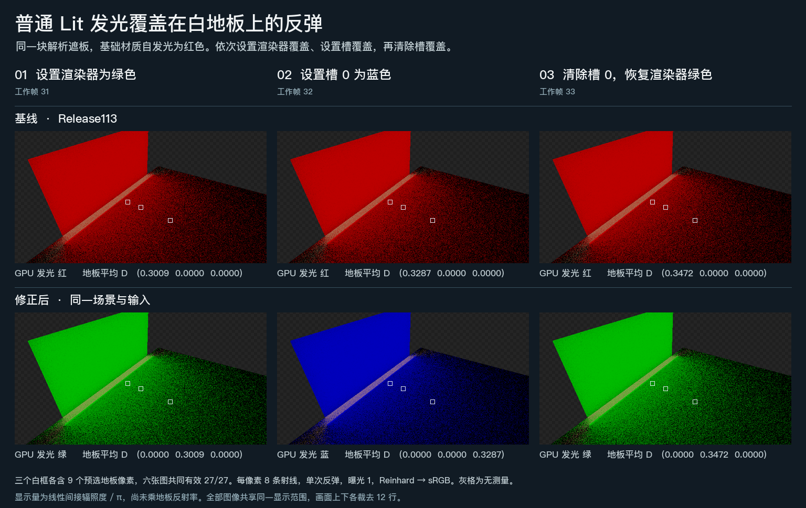

# 没有可用图卡时，单槽 Lit 的换色能传到白地板

同一块遮板的共享材质发红光。先用 Renderer 级 MaterialPropertyBlock 把发光改绿，再用材质槽 0 的覆盖改蓝，最后清除槽 0 覆盖。Release113 在三帧中都向 GPU 上传了共享材质的红色，地板也始终收到红光。Release114 按绿、蓝、绿更新，调用方无需手动标记代理变脏。

| 地板的工作帧与操作 | 旧版平均间接 RGB | Release114 平均间接 RGB |
| --- | --- | --- |
| 31，Renderer 改绿 | (0.30093, 0, 0) | (0, 0.30093, 0) |
| 32，槽 0 改蓝 | (0.32870, 0, 0) | (0, 0, 0.32870) |
| 33，清除槽 0 | (0.34722, 0, 0) | (0, 0.34722, 0) |

六帧都取同一批 27 个已知白地板像素，对应的相机、深度、几何与地板材质一致。表中 D 是间接漫反射辐照度除以 π，取自乘接收面反射率之前。同一工作帧的幅值保持一致，修复改正了贡献所在的色道。实际 GPU 代理记录也逐帧由红／红／红改为绿／蓝／绿。[线性读数、输入条件及 GPU 记录](result.json)

**适用范围**　Unity 6000.0.85f1、D3D12、640×360、单次世界空间反弹，每像素 8 条射线。遮板有普通不透明 URP Lit 单槽 MeshRenderer，启用材质读取。它的网格不可读，未绑定 SDF，板所在层不参加图卡捕获。三个时点逐项读回了板的实际槽位，均有 0 张图卡、0 个精确几何标记。地板与墙面均有精确网格和图卡。初次布置的材质没有启用发光，采集在渲染前停止；表中基线和修复版使用同一份已确认启用发光的材质。

本次实机画面验证了均匀发光覆盖及其移除。基础色的 shader 空间读取、槽 0 拥有覆盖时的优先级与清除行为另由实际 Proxy 源码的托管用例检查。纹理图案、多槽命中和开启时间历史后的多跳收敛仍各有自己的适用条件。
