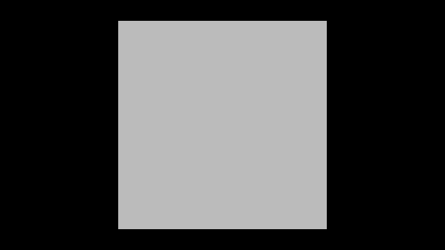

# 白炉：普通相机的均匀环境反射

Release99 产品源码 `e207593` 在 Unity 6000.0.85f1、Direct3D 12、RTX 2080 Ti 上取得一帧普通渲染结果。中央 64×64 像素的线性间接出射 RGB 均值为 **(0.99902347, 0.99902347, 0.99902347)**，相对理论值 (1,1,1) 各低 **0.09765%**。这个白炉场景给出了普通 Feature 从均匀环境输入到屏幕出射贡献的整条路径的观测。

PNG 采用一致的 Reinhard 映射和线性转 sRGB，所以单位亮度显示为浅灰。下列数字从色调映射前的 RGBA32F 读回取得。[原始线性 EXR](frame-0000.exr) · [数值与采样区域](result.json)

| 固定内区 | R | G | B |
| --- | ---: | ---: | ---: |
| 理论出射值 | 1 | 1 | 1 |
| 实测最小值 | 0.9990234375 | 0.9990234375 | 0.9990234375 |
| 实测均值 | 0.9990234673 | 0.9990234673 | 0.9990234673 |
| 实测最大值 | 0.9990234971 | 0.9990234971 | 0.9990234971 |

4096 个像素均为有限值，每个像素的 R、G、B 相等。最大绝对通道偏差为 0.0009765625。普通出射图包含采样、滤波、上采样、反射率和合成各阶段。中间 D 和独立有效性掩码未读回，无法由该结果把偏差分配给具体阶段。

## 场景与事先固定的比较口径

本次只取一个无遮挡平面的一张普通 IndirectOnly 线性 HDR，使用现成 ComparisonCapture。量为漫反射间接出射贡献。常量入射辐亮度每通道为 1，余弦半球积分给出 D = E/π = 1。材质为白底、黑色镜面反射率的 URP Lit 镜面工作流，漫反射率为 1；AO 和 GI 强度也为 1。中央区域的理论出射 RGB 因此为 (1,1,1)。该平面只作为屏幕接收面，场景没有代理、遮挡物、解析灯和发光面。

采集前固定区域为 640×360 输出中央的 64×64 像素，零基索引 x=288…351，y=148…211。报告 RGB 均值、与理论值的最大绝对通道差和未知边界。参考值来自上述独立半球积分，不从相邻帧或当前画面拟合。读取普通出射 HDR，只对选定内区给出数值结论。多跳封闭白室、材质边缘和整景能量仍在此范围之外。

本次观测使用软件后端、2 条射线、4 级空间滤波、半分辨率 GI，关闭方向引导与发光体采样。逻辑帧 0 有目标相机渲染收据，GI 帧计数为 1，目标相机输出和回读成功。普通采集器按请求完成 1 帧和 1 次读回、记录 0 个错误，进程退出码 0。原通用采集器保留 `incomplete-probe` 及 `fullSequenceCompleted=false` 来区别于完整 720 帧序列。[运行收据](run.json) · [实际 Feature 配置](feature.json) · [场景输入](WhiteFurnaceEditor.cs)

退出日志另报一条 1 MiB 的 D3D12 内部 scratch buffer 未释放提示。这里只将本次结果用于能量对照，资源退休与整进程长期内存仍归 G4／G5 验收。
