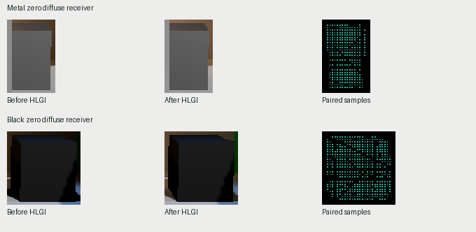

# 黑色与全金属接收面的合成前后对照

历史 V209 第 119 帧的加法合成保留了这两个接收面的原生颜色。全金属区域的 298 个采样点和黑色区域的 473 个采样点，合成前后逐点线性 RGB 最大绝对通道差均为 **0**。同一帧中另有像素发生了实际颜色变化。

| 源材质 | 配对内部点 | 合成前已有非零 RGB 的点 | 合成前 RGB 通道范围 | 合成后 RGB 改变的点 |
| --- | ---: | ---: | ---: | ---: |
| 全金属，金属度 1、灰色底色 | 298 | 298 | 0.047561 至 0.135123 | 0 |
| 黑色，金属度 0、底色 RGB 全零 | 473 | 446 | 0 至 0.024727 | 0 |

左、中列显示相同相机位置的合成前后裁切图，采用一致的 Reinhard 与 sRGB 显示映射。右列青色点标出实际比较位置，其他像素仅提供周围场景背景。参与测量的两组材质捕获 RGB 漫反射率都是零。黑色底色的 Lit 材质在原生渲染中仍可有非零颜色，上表给出了实际保留的部分。

原始量来自同一次普通 Feature 的 Final／Additive 合成前后浮点相机颜色，位于 skybox 之后、透明物体之前。采集器记录逻辑帧 119、引擎帧 123、工作帧 119，两端都已完成读回。使用与该帧匹配的已有源几何主射线数据，按对象身份选取内部点，再用其保存的全分辨率像素坐标读取 640×360 两张图。几何边界、天空、未支持的输入不参与选择。所选点全部有配对有效且覆盖的材质，摄像机深度和捕获深度相等，和源几何投影的设备深度最大差为 3.68×10⁻⁷ 以下。[选择与比较代码](compare.py) · [实际数值](result.json) · [原 V209 数据来源](../../../Documentation/ReviewBrief-ValidationSourcePackageV2.md)

这补齐了原 G1 在该帧上“零漫反射不增加漫反射 GI，已有相机颜色得以保留”的画面对照。直接光与镜面分量未单独分解，其绝对准确度和其他合成模式仍需各自依据。本次复用了历史图像。Release99 的白炉实测另有独立来源。[Release99 白炉](../white-furnace-ordinary-01/result.md)
