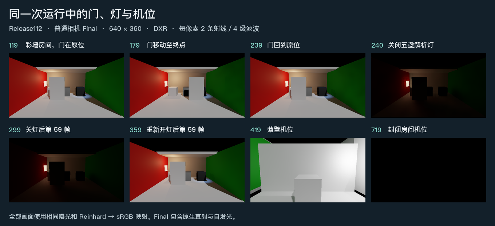
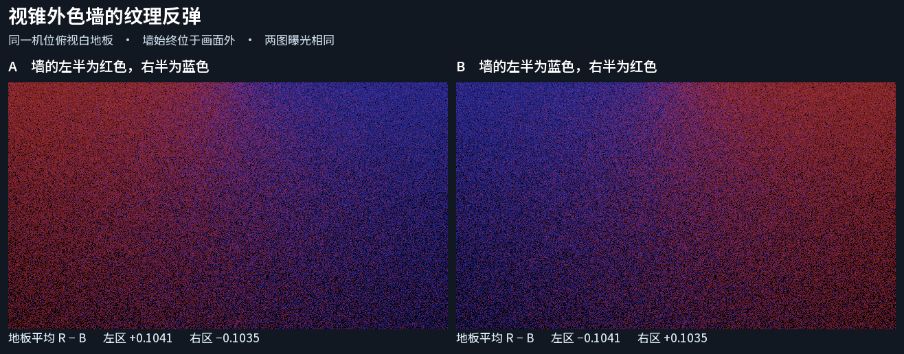
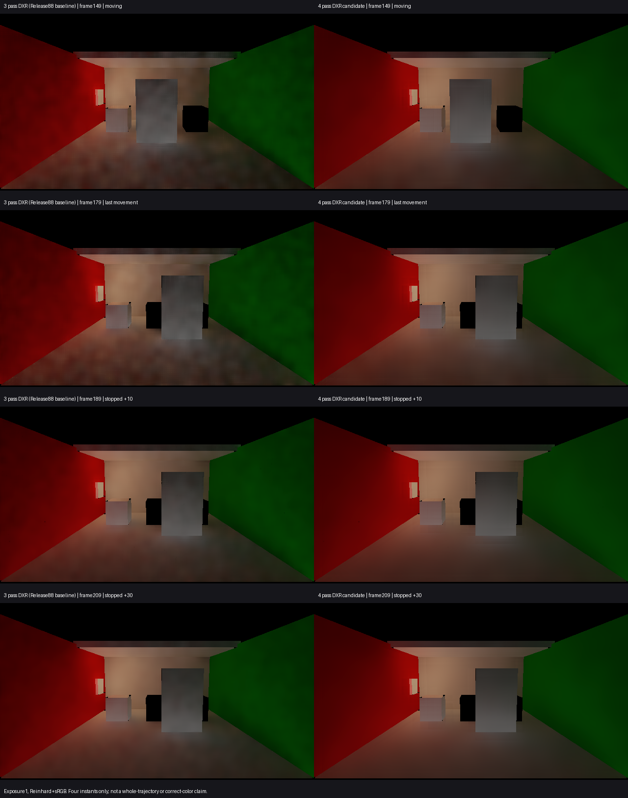

<div align="center">

# HybridLumenGI

**面向 Unity 6 / URP 17 的实验性实时漫反射全局光照**

网格 SDF · 表面缓存 · 渐进多次反弹 · 时域重建 · 软件追踪 / DXR

[下载体验](#开始体验) · [画面对照](#画面与取舍) · [接入工程](#接入自己的工程) · [技术文档](#技术文档)

</div>



<p align="center"><sub>真实相机输出 · Release112 / DXR / 640×360 · Final 含原生直射、自发光与 GI。<a href="LocalComparison/Review/full-dxr-sequence-112/result.md">画面来源与范围</a></sub></p>

HybridLumenGI 以网格距离场和表面材质描述场景，在世界空间累积间接光，再通过时域重建与空间滤波输出到 URP 相机。它关注视锥外的颜色反弹、光照变化后的响应，以及动态几何与分页资源之间的一致性。

**当前交付为 Release134，默认独立分页 HLOD 按每台相机的完整发布显示，修复粗根与细节同画。** 可运行示例和可编辑 Unity 工程使用同版源码。项目仍处于实验阶段，完整生产验收持续推进。[修复范围](LocalComparison/Review/independent-hlod-raster-151/release-notes.md)

## 开始体验

| 你想做什么 | 下载 | 打开方式 |
| --- | --- | --- |
| **直接看效果** | [Windows x64 演示包](https://github.com/Ranko-sama/HybridLumenGI/releases/download/release134-demo/HybridLumenGI-Release134-Windows-x64.zip) | 完整解压到新目录，运行 `Start-LocalRelease.cmd`。 |
| **检查场景与实现** | [可编辑 Unity 工程](https://github.com/Ranko-sama/HybridLumenGI/releases/download/release134-demo/HybridLumenGI-Release134-UnityProject.zip) | 用 Unity Hub 添加解压目录，使用 **6000.0.85f1** 打开。 |
| **先看独立对照** | [两室关门的同曝光对照](LocalComparison/Review/portal-recovery-138/result.md) | 可直接看报告。Windows 包中的 `PictureComparison/index.html` 提供完整离线画册。 |

Release134 两个包均附带 `LICENSE` 和 `NOTICE`。请保留运行包旁的数据目录与资源页。

**示例配置：** Windows x64 · DirectX 12 · Linear · URP 17.0.4 · 960×540 · 半分辨率 GI · 每像素 2 条射线 · 4 级空间滤波。启动时优先请求 DXR，实际后端以面板与日志为准。[打开场景与重新构建 →](Documentation/UnifiedUnityProject.md)

### 建议的观察路线

1. **看颜色。** 对准白色地板，按 `C` 切换墙色；用 `F5` 在最终画面与仅间接光之间切换。
2. **看动态。** 按 `M` 启停门运动，观察门面颗粒与旧位置轮廓；按 `L` 开关解析灯。关灯后发光材质仍会发光。
3. **看空间与资源。** 按 `F3` 进入两室，再按 `F4` 进入三室；穿过右侧开口、横移至中央门，按 `O` 开关滑门。用 `1` / `2` 比较近景与远景表示。

<details>
<summary><strong>完整操作与调试入口</strong></summary>

点击 Player 窗口后操作。

| 操作 | 按键 |
| --- | --- |
| 移动 / 升降 / 转向 | `WASD` / `Q`、`E` / 方向键 |
| 近景 / 远景 / 离开分页范围 | `1` 或 `R` / `2` / `3` |
| 请求软件追踪 / 优先 DXR | `4` / `5` |
| 两室布局 / 三室布局 / 中央滑门 | `F3` / `F4` / `O` |
| 墙色 / 解析灯 / 门运动 | `C` / `L` / `M` |
| 形变启停 / 切换网格与骨骼来源 | `Space` / `K` |
| 分页组释放与重载 | `B` |
| 最终画面 / 仅间接光 | `F5` |
| 隐藏面板 / 导出状态 / 退出 | `F1` / `F2` / `Esc` |

面板分别显示后端请求与最近录制的实际后端；新请求尚无对应记录时显示 `unknown`。形变采用异步快照，停止运动后 GI 可能继续追上可见网格，`K` 切换的两种模式沿用原物理碰撞体。

GPU 计时、预算反馈和显存观察默认关闭。可先选 **Measure only**，输入预算后再选 **Apply feedback**；最低配额仍可能超出目标。`Memory` 记录本进程 local / nonlocal 采样，不代表 GI 独占或整机显存。[预算与计账](Documentation/GpuBudget.md) · [分页表示状态](Documentation/HlodStreaming.md)

</details>

## 技术能力

| 方向 | 实现与用途 |
| --- | --- |
| **世界空间几何** | 网格 SDF、surface charts 与表面缓存，保留视锥外表面对间接光的贡献；无 charts 时提供明确的六视图近似。 |
| **材质与颜色传输** | 捕获 Lit 漫反射、纹理、发光与属性块，支持渐进多次反弹及发光面采样。 |
| **软件 / 硬件追踪** | 精确软件三角查询与可选 DXR 共用命中材质、alpha / Cull 和 chart 绑定；准入失败时保留 SDF / 解析近似或未知状态。 |
| **动态与重建** | 根据几何、材质与灯光变化调整历史和更新优先级；提供可读网格与骨骼形变的异步快照路径。 |
| **分页与 HLOD** | 独立资产页、异步加载、近远表示切换和完整组发布，配合资源计账与更新预算。 |
| **URP 合成** | 可叠加到原生照明，也可替换受支持接收面的原生漫反射 GI；提供仅间接光视图。 |

**实现取舍：** 未知材质或覆盖不作为可信黑值参与光传输；HLOD 就绪表示完整组可提交，不等于照明已收敛。几何、缓存和历史的具体合同见 [安装与实现](Documentation/Implementation.md)。

## 画面与取舍

### 视锥外的材质，仍能影响可见表面



相机始终只看白地板，色墙完全位于视锥外。交换墙面的红蓝纹理后，地板两侧的主导颜色也随之交换。这组图使用关闭时空滤波的单帧采样，因此保留了颗粒；它展示的是离屏材质贡献，不是默认配置的画质。[输入、原始线性 EXR 与适用范围 →](LocalComparison/Review/offscreen-wall-texture-01/result.md)

### 运动画质：减少云斑，接受适度柔化

当前保留 **2 条射线 / 4 级滤波** 的取舍。在同一路线、同一曝光的四个时点，较 3 级滤波明显减弱门面与地板云斑，未见明显加重的旧门轮廓；连续弱拖尾的幅度和时长仍未知。

<details>
<summary><strong>展开同曝光运动对照：3 级 / 4 级滤波</strong></summary>



原四个时点的来源、曝光与限制见 [对照报告](LocalComparison/Review/four-pass-local-quality-01/result.md)。

</details>

### 颜色、残留与恢复，能回答到哪里？

| 问题 | 已有观察 | 结论边界 |
| --- | --- | --- |
| **[颜色误差](LocalComparison/Review/archived-runtime-color119-01/result.md)** | Release122 同源 Runtime 在原归档场景中，Floor / White 两个区域的平均间接光 D 亮度较有限参考低 **3.075% / 0.831%**。 | 640×360、固定第 119 帧、两个 ROI；地板 2 个未知点单列。不是当前三室、普通 Player 或全图真值。 |
| **[关灯残留](LocalComparison/Review/all-source-off-response-01/result.md)** | 实际棕墙 / 白地板光路，全源关断后 **0.985 / 1.985 秒**，27 个固定点的旧绿均值剩 **0.2774% / 0.02529%**。 | 限该输入与光路，末端实际过滤数据有效；不能称白墙、高反射率或最坏情况通过，也不等同示例 `L` 键事件。 |
| **[运动拖影](LocalComparison/Review/four-pass-local-quality-01/result.md)** | 四个同曝光时点中，颗粒减弱，未见明显加重的旧门轮廓。 | 不覆盖帧间闪烁、弱拖尾的连续持续时间或任意动画。 |
| **[换色恢复](LocalComparison/Review/final-state-response-01/result.md)** | 既有绿转蓝光路的 Final 区域均值，首个合格保持窗口为 **0.194–0.708 秒**，后续观测至 2.613 秒未再越线。 | 相对同工作帧的产品蓝色控制；窗口起点最差单点仍差约 23%。不是全像素或物理精确收敛。 |
| **[两室关门恢复](LocalComparison/Review/portal-recovery-138/result.md)** | 约两秒的地板暖光残留由 **10.33%** 降到 **0.214%**。修复后的首个 ≤1% 保持窗为 **1.373–1.894 秒**。 | 960×540 实际 DXR，固定两室地板与匹配闭门控制。读数取 2 秒截止点前后的实际源帧。 |

各行来自不同场景与观察，不能拼成一次完整验收。D 为 `E_indirect / π`，未乘接收面反射率、AO 或合成强度；秒级响应使用约 29 Hz 的连续显式渲染请求，不是普通 Player 帧率测量。反射率换色的 White 区域控制仍不足，几何遮挡变化后的恢复也未闭合。[四问完整说明](LocalComparison/Review/dynamic-picture-comparison-01/report.md) · [画册交付范围](LocalComparison/Review/picture-delivery-20261104/result.md)

## 接入自己的工程

### 1. 导入产品源码

在 Unity 6 URP 工程中创建 `Assets/HybridLumenGI`，复制以下产品目录及随附 `.meta`，保留 `Runtime/Resources`：

```text
Assets/HybridLumenGI/
├── Runtime/     运行时、资源与示例交互
├── Editor/      代理注册、烘焙、分页与构建工具
└── Shaders/     捕获、追踪、缓存、重建与合成
```

`LocalComparison`、`Tests`、`Delivery` 为开发资料，留在 Unity 工程外。当前通过源码目录导入，没有 UPM `package.json`；不要将整个仓库放入 `Assets` 或重复导入产品源码。

### 2. 配置渲染与几何

- 使用 **DX12、Linear、Render Graph**，在相机实际使用的 Universal Renderer Data 中添加一次 `HybridLumenGIRendererFeature`。
- 执行 **Tools → Hybrid Lumen GI → Setup & Proxies** 注册 Renderer。真实网格路径需要可读网格，并烘焙、绑定匹配的 SDF 和 surface charts；编辑几何后可能需要重烘焙。
- Shader 资源自动加载；Feature 请求深度、法线和运动矢量，不要求 Opaque Texture。

### 3. 选择合成方式

| Composition | 适用方式 |
| --- | --- |
| **Additive** · 默认 | 保留原生环境光与光照贴图，叠加 HLGI 的贡献。 |
| **Replace Native Diffuse GI** | 让 HLGI 接管受支持的不透明 URP Lit 接收面的漫反射 GI。使用 Forward、关闭 MSAA、启用 HDR，并选择 **HDR Precision → 64 Bits**；相机 RT 使用 RGBA16F 或 RGBA32F。 |

替换模式会扣除完整原生漫反射项，包括已烘入贴图的直射。`Indirect Intensity = 0` 仅关闭 HLGI 贡献；要恢复完整原生画面，请关闭 Feature。[合成支持矩阵](Documentation/NativeDiffuseComposition.md)

进一步操作：[升级与回退](Documentation/Implementation.md#升级已有-unity-工程与回退) · [生成统一示例](LocalComparison/Implementation/UnifiedSample/SAMPLE.md#生成及使用) · [构建普通 Player](Documentation/BatchPlayerBuild.md)

<details>
<summary><strong>运行时更新与示例输入</strong></summary>

- 原地修改可读网格后，调用 `MarkDirty()` 或 `HybridLumenGIMeshSource.NotifyGeometryChanged(mesh)`；形变需使用匹配网格、SDF 与 charts 的快照流程。
- 外部 GPU 纹理写入需要明确的更新通知和生产者顺序，不能仅凭对象引用推断内容变化。
- 示例通过 `UnityEngine.Input` 读取按键，**Active Input Handling** 选择 **Input Manager (Old)** 或 **Both**。这不限制单独接入 Renderer Feature 时的输入方案。
- 生成的分页资源位于 `Assets/StreamingAssets`。修改源网格、贴图或材质后，按对应工具流程重建资源页。
- 原生 GPU 计时 / 显存观察为可选 DLL，源码导入不会自动安装。[部署说明](Documentation/NativeGpuTiming.md)

</details>

## 性能参考

起始目标为 **960×540 / 30 FPS、GI 三个区间合计 p95 ≤25 ms、进程 local 显存有限采样峰值 ≤1 GiB**，nonlocal 单独列出。

以下本机结果使用 RTX 2080 Ti、Unity 6000.0.85f1 / URP 17.0.4、Windows x64 / Mono / DX12 / Linear，半分辨率 GI、2 条射线、4 级滤波。

| 实测窗口 | 结果 | 适用范围 |
| --- | --- | --- |
| **[Release117 · 三室中室](LocalComparison/Review/three-room-middle-budget-117/result.md)** | GI 合计 p95 **16.170 ms**；进程 local / nonlocal 峰值 **566.191 / 287.438 MiB**。 | 五灯、开门、完整近景细节的固定机位；该窗口满足起始 GI / local 预算。 |
| **[Release119 · 普通 Player](LocalComparison/Review/three-room-middle-present-119/result.json)** | 应用 Present 平均 **56.44 Hz**，间隔 p95 **20.278 ms**。 | 960×540、30 秒静止窗口，机位与上一窗口略有差异；未测显示帧率、GI 专项时间或显存。 |

两个窗口不能合成为同一次性能验收，也不外推到运动、冷入、其他硬件或 Release122 的全部场景。显存为进程有限采样峰值，不是 GI 独占或绝对瞬时峰值。[预算、计时与边界 →](Documentation/GpuBudget.md)

## 支持范围

| 范围 | 当前边界 |
| --- | --- |
| **相机与平台** | Base Game 相机及显式允许的 Scene View。非 DX12、非 Linear、Overlay、XR / 立体与纹理数组目标会跳过。 |
| **材质** | 主要面向普通 opaque / cutout URP Lit；Shader Graph、透明、自定义顶点变形、镜面 GI 与完整软阴影语义不在同一支持承诺内。 |
| **动态几何** | 已有可读网格与骨骼快照路径；Cloth、blend shapes 及自定义 GPU 变形不在当前合同内。不承诺任意动画无拖影或固定帧数收敛。 |
| **分页与规模** | 冷高速首次入场仍可能出现完整表示空档；单页复用的位置精度合同有未通过项，不能概括为池复用整体通过。 |

**开发状态：** G0 本机基线已锁定，原计划第 6 节的 G1 传输与 G2 几何已完成本机代表性验收；G3–G5 及专项仍开放，CI 暂缓。各结论保留原版本、输入与接收域，不推广为全部 Lit 输入或三室所有像素通过。

[完整支持矩阵](Documentation/ProductionPlan.md#当前支持范围与证据层级) · [剩余任务](Documentation/RemainingWork.md) · [已关闭缺口与阶段历史](Documentation/DevelopmentProgress.md) · [原始开发计划](Documentation/OriginalDevelopmentPlan.md)

## 技术文档

| 主题 | 阅读入口 |
| --- | --- |
| **接入与构建** | [安装与实现](Documentation/Implementation.md) · [可编辑示例工程](Documentation/UnifiedUnityProject.md) · [批处理构建](Documentation/BatchPlayerBuild.md) |
| **几何与缓存** | [几何、法线与历史合同](Documentation/GeometryHistoryContracts.md) · [表面缓存](Documentation/SurfaceCache.md) · [形变快照](Documentation/DeformedGeometry.md) |
| **光照与合成** | [直接光与阴影](Documentation/DirectLighting.md) · [环境输入](Documentation/EnvironmentRadiance.md) · [发光采样](Documentation/EmissiveSampling.md) · [原生漫反射合成](Documentation/NativeDiffuseComposition.md) |
| **驻留与调度** | [SDF 驻留](Documentation/SdfAtlasResidency.md) · [全局 SDF](Documentation/GlobalSdf.md) · [BVH 与调度](Documentation/SceneBvh.md) · [独立资产页](Documentation/IndependentAssetPages.md) · [HLOD](Documentation/HlodStreaming.md) |
| **评估与研究** | [画质工程判据](Documentation/QualityAcceptance.md) · [运行验收](Documentation/Validation.md) · [研究来源](Documentation/Research.md) · [社区源码与许可](Documentation/CommunitySourceAudit.md) |

## 许可证

除另有标注的第三方内容外，本项目原创代码、文档与示例内容采用 **[Apache License 2.0](LICENSE)**。

Unity、ACES 等第三方内容保留各自许可，详见 [NOTICE](NOTICE)。分发可选原生插件时，请同时保留 [原生插件第三方通知](Documentation/NativeGpuTimingThirdPartyNotices.md)及其引用许可。公开源码不改变 Unity 引擎及相关依赖的许可条件。
